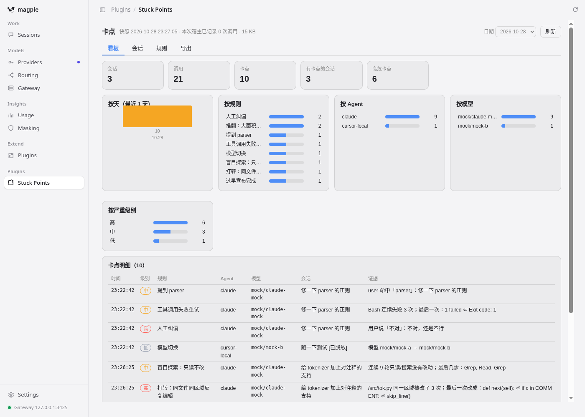
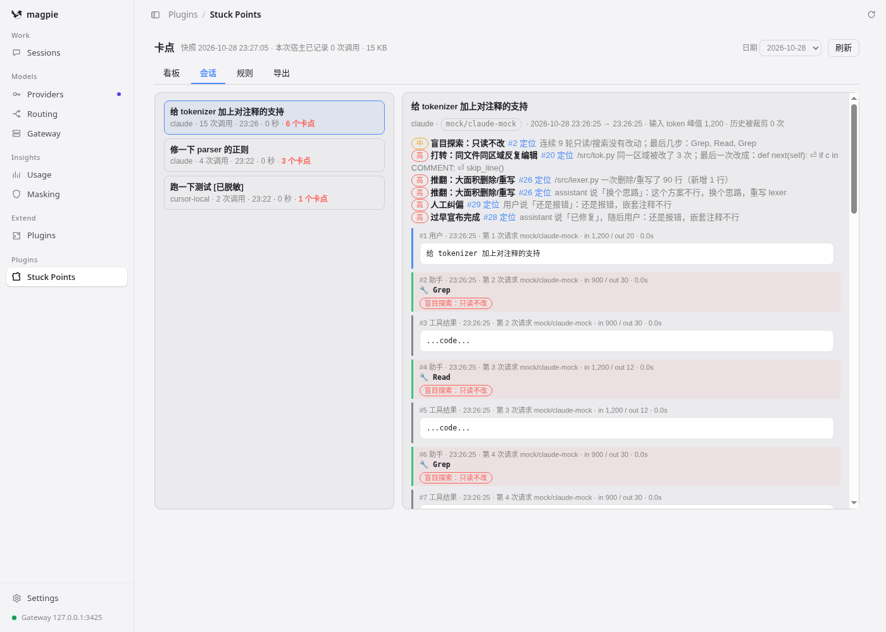
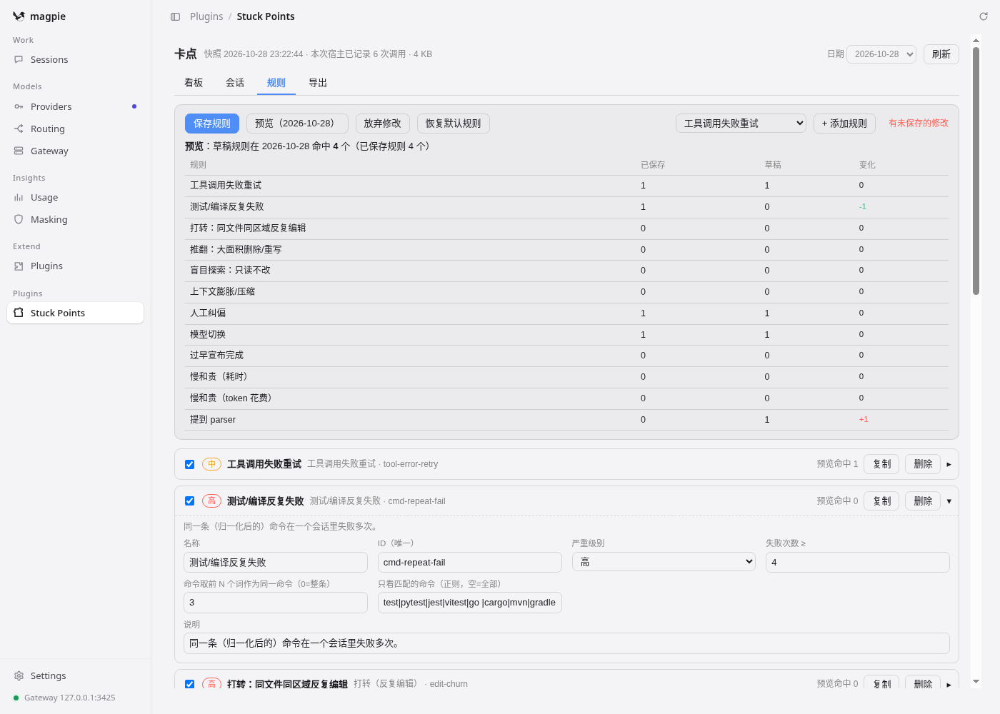

# magpie-stuck · 卡点

Magpie 的**内置插件**（不需要另起网页或服务）：在 Magpie 网关里记录每一次 Agent 调用，用**可编辑的声明式规则**找出编程 Agent 的「卡点」，在 Magpie App 侧边栏 **插件 → 卡点** 页面里可视化展示和编辑规则。支持**导入 Claude Code / Codex 的历史会话**，并提供**今日 / 近3天 / 近7天 / 近30天**多时间维度报表。

结构和接入方式完全照 [begend/magpie-model-health](https://github.com/begend/magpie-model-health)：`magpie.hooks`（Bun 插件宿主里的网关钩子） + `magpie.page`（App 内沙箱页面） + `options._status` 快照。

## 能发现哪些卡点（15 条默认规则，全部可改）

| 规则 | 说明 |
|---|---|
| 工具调用失败重试 | 同一工具连续报错 ≥ N 次（`is_error` 或输出命中错误模式） |
| 测试/编译反复失败 | 同一根因（错误签名相同，可以是不同命令）的失败链 ≥ 2 次；工具失败重试还区分「参数相同的盲试」与「调整参数在适应」 |
| 打转 | 同一文件同一区域被反复编辑（后一次的 old_string 与上一次的 new_string 有重叠行） |
| 推翻 | 单次删除大量行 / 会话累计删除远多于新增 / assistant 说「换个思路」「重写」「回滚」 |
| 重复劳动 | 重复读取相同内容、重复执行得到相同结果的命令（中间有编辑且结果变了算验证，不算）、编辑改了又改回去（增量被撤销判定，不受函数骨架行干扰） |
| 无进展循环 | 一段时间内持续失败但错误签名不变（同一根因反复尝试），并检测后续是否恢复、窗口内消耗了多少 token |
| 回归与返工 | 同一验证命令先前通过、经过代码修改后失败——新修改弄坏了已验证的行为 |
| 盲目探索 | 连续 N 轮只读（Read/Grep/ls/cat…）没有任何修改 |
| 上下文膨胀 | 输入 token 突增、超过上限，或历史被裁剪/压缩 |
| 人工纠偏 | 用户说「不对」「重来」「还是报错」「you broke」… |
| 完成声明缺验证 | 宣布完成但最后一次修改后没有成功运行过验证（implemented ≠ verified）；验证仍在失败时宣布完成更判高危。受阻声明与纯问答会话不判 |
| 需求偏离 | 确定性子集：用户说「只分析/不要改」仍修改文件；同一纠偏说法出现 ≥ N 次；修改用户从未提及的文件（默认关） |
| 模型切换 | 同一会话中途换模型 |
| 慢和贵（耗时） | 会话总耗时 ≥ 当天同任务类型（修复/开发/理解/文档，启发式分类）中位数 × 3 |
| 慢和贵（token） | 会话 token 量 ≥ 当天同任务类型中位数 × 3 |

还可以添加「自定义关键词」「自定义阈值」规则，以及复制任意规则改参数。

## 问题片段（Signal ≠ Issue ≠ Root Cause）

单条规则命中只是**信号**；「问题」标签页把同一会话内时间相近、互相关联的信号聚合成一个**问题片段**：标题、置信度、证据链（每个信号的原文摘录）、影响（返工操作数、窗口消耗 token、是否恢复）和根因**假设**分类（`insufficient_diagnosis` / `requirement_misunderstanding` 等，`status: hypothesis`，留给人工或后续 LLM 确认）。看板的区间汇总里「问题片段」数 = 每日聚合后的条数，比原始卡点数更接近"实际出了几件事"。

## 安装（和 model-health 一样）

需要 Magpie 带插件宿主（Bun）——`magpie plugin list` 能看到插件即可。

```bash
tar xzf magpie-stuck-plugin.tar.gz          # 解压到一个固定位置，例如 ~/magpie-plugins/
magpie plugin add ~/magpie-plugins/magpie-stuck-plugin
magpie plugin list                          # 应看到：async gateway hook / page  Stuck Points
# 可选：改选项（名字用文件夹名）
magpie plugin options magpie-stuck-plugin '{"publishSeconds":60}'
# 重启 Magpie（App 退出重开，或重启 magpie serve / magpie daemon restart）
```

然后正常用 Claude Code / Codex / Cursor CLI / OpenCode 等经本机 Magpie 发请求，打开 App 侧边栏 **插件 → 卡点**（英文界面显示 Stuck Points）。首次数据约 2 秒后出现，之后每 `publishSeconds` 秒最多刷新一次。

`magpie serve --web` / `magpie web` 的浏览器界面里同样有这个页面。

卸载：`magpie plugin remove ~/magpie-plugins/magpie-stuck-plugin`（数据目录需要手动删除）。

## 历史会话导入（Claude Code / Codex）

网关只能记录安装之后的调用；之前的历史会话可以从 agent 本地的会话文件离线导入：

```bash
npm run import            # 或 node scripts/import-history.mjs
node scripts/import-history.mjs --dry      # 只统计不落盘
```

- 来源：`~/.claude/projects/`（含 `<会话>/subagents/` 子代理会话）与 `~/.codex/sessions/`，可用 `--claude-dir` / `--codex-dir` 改。
- 转换成与网关记录相同的格式，写入 `<数据目录>/imported/YYYY-MM-DD.jsonl`；导入前脱敏，与落盘数据同样的截断上限。
- **去重是会话级、捕获优先**：会话的 uuid 哈希（= 网关记录的 `session_header`）或算出的会话 id 出现在 `calls/` 里 → 整个会话跳过（网关捕获带真实耗时/来源，优先用捕获的）；`manifest.json` 记录已导入文件（大小+mtime），重复运行幂等；分析时 `mergeCalls` 再兜底一次。
- 会话被压缩/改写在导入里还原成「历史被裁剪」信号；Magpie 的 `usage.jsonl` 里同会话的真实耗时 / token / 实际模型会按时间对齐补进导入记录。
- 重复运行只增量处理变化过的文件；导入数据不参与 `retainDays` 清理（删掉 `imported/` 即可全部重来）。

## 时间维度（今日 / 近3天 / 近7天 / 近30天）

页面顶部的区间切换：**KPI、按天趋势、各分布图**来自宿主发布的每日汇总（捕获 + 导入合并后计算，最近 40 天，每天约 1KB，不受快照体积限制）；**卡点明细表**只能列快照内的最近几天（默认 3 天，点趋势图某天回到单日视图，点明细行跳会话时间线）。更早的完整明细用「导出」页的**区间 JSON（宿主完整数据）**或命令行：

```bash
npm run export -- 2026-10-28                       # 单日（含导入数据，去重）
npm run export:range -- 2026-10-20 2026-10-28      # 区间（闭区间，最多 62 天），--csv 出卡点 CSV
```

## 页面





- **看板**：日期选择、KPI、最近几天的趋势，按规则 / Agent / 模型 / 严重级别的分布（点击即筛选），卡点明细（点一行跳到会话时间线的对应消息）。
- **会话**：当天的会话列表（卡点多的排前面）和完整时间线：用户消息、助手回复、工具调用（命令、改了哪个文件多少行）、工具结果（失败标红）、每条消息命中的规则。会话头部有质量指标卡：任务类型、重复失败率（无新错误签名的失败占比）、首次验证结果、纠偏次数、时间构成（网关活跃 + 用户间隙）。
- **问题**：问题片段卡片流——多个信号合并成一件事，附证据链、影响估算和根因假设；点「查看会话」跳到片段起始消息。
- **规则**：可视化编辑——启用/停用、改名称、严重级别、所有阈值/关键词/正则（按规则类型自动生成表单）、添加/复制/删除规则、全局设置（哪些工具算只读/编辑/命令行、错误模式）、原始 JSON。**预览**用草稿规则在当天数据上重跑，对比每条规则命中数的变化；**保存**写进 Magpie 的插件配置（plugins.json 里本插件的 `options.rules`）。
- **导出**：下载 JSON / 卡点 CSV、复制 JSON；「写到本机文件」让插件宿主把整天完整数据写到 `<数据目录>/exports/magpie-stuck-YYYY-MM-DD.json`。

## 工作原理

```
Agent ──► Magpie 网关 ──► 上游
             │ onRequest(body, ctx)    记下开始时间（不改请求）
             │ onResponse(reply, ctx)  ctx.request + 拼好的回复 + agent/session/origin/model
             ▼
   stuck.hooks.js（Magpie 的 Bun 插件宿主）
     · 归一化 Anthropic / OpenAI Chat / Responses / Gemini 四种协议
     · 脱敏（sk-…、ghp_…、JWT 等 → [已脱敏]），文本超长截断
     · 增量存储：只存相对上一次请求新增的消息 → calls/YYYY-MM-DD.jsonl（0600）
     · 节流把最近 3 天精简会话写进 plugins.json 本插件的 options._status
             ▼
   page/（App 内沙箱 iframe，CSP 禁止网络）
     magpie.options.get() 读快照 → core.js 规则引擎在页面里实时跑 → 看板/时间线
     magpie.options.set() 保存规则 / 发起导出
```

- `page/core.js` 是共享核心（协议归一化、会话重建、规则引擎），宿主和页面用同一份代码；`scripts/build-page.mjs` 把它和 `page/app.js` 打成经典脚本 `page/app.bundle.js`（沙箱页面不能加载 ES module）。
- 只记录 `origin` 为 `local`、`gateway-key` 的调用（Magpie 文档建议导出对话的插件默认跳过远程/未知来源），可用 `captureOrigins` 修改。
- 会话 = Agent + 会话头（X-Magpie-Session、x-claude-code-session-id 等）+ 第一条用户消息的哈希，所以 Claude Code 的子 Agent 会被分成独立会话。

## 数据位置

`<配置目录>/magpie-stuck/`，配置目录 = `MAGPIE_STUCK_CONFIG_DIR` 或 `$XDG_CONFIG_HOME/magpie` 或 `~/.config/magpie`（和 Magpie 自己的配置在一起）：

- `calls/YYYY-MM-DD.jsonl`：每次调用一行（时间、agent、来源、协议、请求/服务的模型、状态、耗时、token、增量消息、回复）
- `imported/YYYY-MM-DD.jsonl`：历史会话导入（`manifest.json` 记录进度）
- `exports/`：导出文件

数据只留在本机，插件没有任何外发网络请求。

## 选项（`magpie plugin options magpie-stuck-plugin '{...}'`）

| 选项 | 默认 | 说明 |
|---|---|---|
| `captureOrigins` | `["local","gateway-key"]` | 记录哪些来源，可加 `"remote"`、`"unknown"` |
| `ignoreAgents` | `[]` | 不记录的 Agent 名，例如 `["claude"]` |
| `publishSeconds` | `90` | 快照最短间隔（秒） |
| `snapshotDays` | `3` | 页面能看的天数 |
| `snapshotMaxKB` | `600` | 快照上限，超了自动缩短文本/减少天数 |
| `retainDays` | `30` | 本机数据保留天数 |
| `maxTextChars` | `20000` | 落盘时单段文本上限 |
| `outputDir` | `magpie-stuck` | 数据目录（相对配置目录或绝对路径） |
| `rules` | 内置 11 条 | 由「规则」页面维护，也可以手写 JSON |

注意：`magpie plugin options` 会**整体替换** options，手动改时带上 `rules`，或者直接在页面里改规则。

## 命令行导出

```bash
cd ~/magpie-plugins/magpie-stuck-plugin
node scripts/export-day.mjs 2026-10-28            # → <数据目录>/exports/magpie-stuck-2026-10-28.json
node scripts/export-day.mjs 2026-10-28 --csv --out hits.csv
```

## 开发

```bash
npm run build   # 生成 page/app.bundle.js（改了 core.js / app.js 后必须运行）
npm test        # 规则引擎、页面（node:vm 假 bridge）、合并/导入器（真实夹具）、宿主（真实 bun）测试
npm run check
```

## 已知限制

- **快照会让 Magpie 重启插件宿主**：Magpie 发现 plugins.json 变化就会重启宿主（model-health 也一样），所以快照有节流（默认 90 秒、且只在有新调用时写）。重启很快，不影响网关转发；页面保存规则、发起导出也会触发一次重启。
- 页面里的文本是精简过的（用户消息约 600 字、工具结果保留首尾各 300 字），规则在页面里基于精简数据实时运行，宿主也会用完整数据算一遍（看板上的数字以页面为准）。完整数据见本机 jsonl 或导出文件。
- 快照上限约 600 KB；会话特别多时会自动缩短文本，再不够就减少天数。更早的数据用命令行导出。
- 网关钩子拿不到 Magpie 算出来的费用，所以第二条「慢和贵」按 token 量比较；规则里仍可选 `cost` 指标，但目前没有数据。
- 沙箱 iframe 可能拦截浏览器下载，此时用「复制」或「写到本机文件」。
- 只能看到经过本机 Magpie 的流量：例如 Cursor IDE 自带的模型请求不走 Magpie 就记不到。
- 会话划分是启发式的；改写/压缩历史的 Agent 会在时间线上显示「历史被裁剪」。
- 需要插件宿主（Bun）。宿主没运行时不会记录（Magpie 在第一次网关调用或打开插件页面时启动它）。
